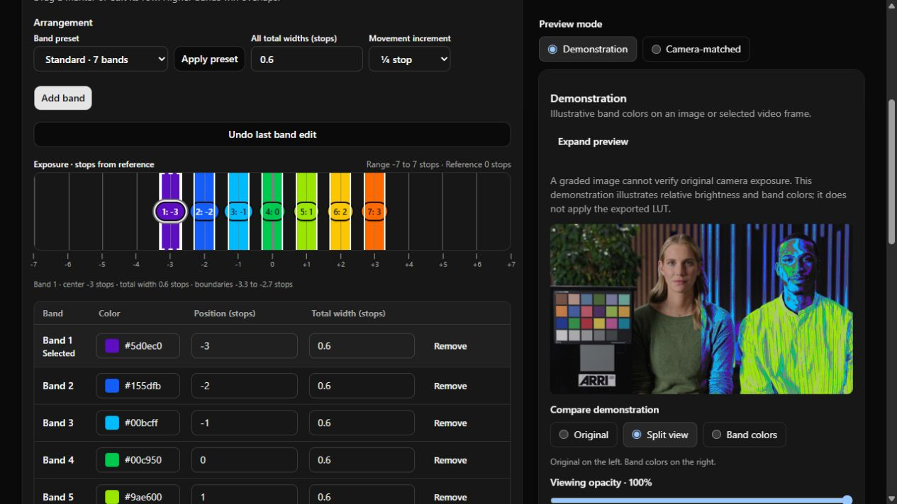

# LUT Builder

Create custom false-color LUTs to check camera exposure. Choose the exposure bands and colors, then export a `.cube` file for your editing software, monitor, or compatible camera.

<p align="center">
  <a href="#roadmap"></a>
  <a href="https://today20092.github.io/lut_builder/"></a>
  <a href="pyproject.toml"></a>
  <a href="LICENSE"></a>
</p>

[Get started](#quick-start) · [Web interface](#web-interface) · [Roadmap](#roadmap) · [User guide](docs/guide.md) · [Report a problem](https://github.com/Today20092/lut_builder/issues)

## Open your browser and make a LUT

**[Open LUT Builder on GitHub Pages](https://today20092.github.io/lut_builder/)** to create and download LUTs in your browser. No installation or terminal commands are needed. The command line and local Workbench remain available as optional tools.

Choose your camera, adjust exposure bands and colors, save named presets in this browser, and download `.cube` files. LUT calculations run on your device. Saved presets do not sync between devices; export setup JSON to back up or transfer your work.

The current browser release supports on-device LUT creation and camera-matched verification for the formats and limits in the [browser support matrix](docs/browser-support.md). A camera-exposure media preview is not included. Phone, touch, and cross-browser testing is still in progress.

## Quick start

These instructions set up the Python CLI and local Workbench. For browser-only use, open the [live app](https://today20092.github.io/lut_builder/).

You need [Git](https://git-scm.com/) and [uv](https://docs.astral.sh/uv/getting-started/installation/). The setup below is for Windows or macOS. uv manages Python 3.12 or newer and the project dependencies.

Open a terminal and run:

```sh
git clone https://github.com/Today20092/lut_builder.git
cd lut_builder
uv sync --locked
uv run lut-builder workspace
```

The Workbench opens at [127.0.0.1:8765](http://127.0.0.1:8765/). It runs on your computer. Keep the terminal open while you work. Press Enter or Ctrl+C in the terminal to stop it.

On Windows, you can also double-click [workspace.bat](workspace.bat) after setup.

Prefer the command line? Run:

```sh
uv run lut-builder build
```

Follow the prompts to create your LUT. A bare filename saves to `output/luts/`. You can also double-click [build.bat](build.bat) on Windows. On macOS, run `chmod +x build.command` once, then double-click [build.command](build.command).

## What you can do

- Set exposure bands in Stops, IRE, or Fill mode.
- Choose each band's color, position, and width.
- Export a 17, 33, or 65 point `.cube` LUT.
- Choose Rec.709 or Rec.2020 diagnostic output.
- Save a setup as JSON and load it again.
- Generate LUTs locally, without uploading your footage to a hosted service.

See the [user guide](docs/guide.md) for commands, examples, output paths, and how to load a LUT.

## Web interface

The Workbench is the local browser interface. You can drag exposure bands, edit their values, choose colors, and compare a demonstration image.



*Current interface, captured on October 18, 2026. The demonstration preview shows band colors. It does not check original camera exposure or apply the exported LUT.*

The interface is still in development. It already supports setup import and export, LUT generation, and checks on supported camera stills and selected video frames. These checks require the correct source settings. PNG decoding and video checks also need local FFmpeg; video checks need FFprobe.

See the [still guide](docs/still-verification.md) and [video guide](docs/testing/video-verification.md) for supported formats and limits.

Named palettes stay in the browser where you saved them. Use the same browser and `http://127.0.0.1:8765/` to find them again. Clearing browser storage can remove them. Export your setup as JSON to keep its applied band colors in a file.

If port 8765 is in use, close the other workspace or application using it and try again.

## Roadmap

The main priority is [browser-only LUT Builder on GitHub Pages, ticket #9](https://github.com/Today20092/lut_builder/issues/9). The intended experience is to open a link and make a LUT, including on a phone.

| Status | Work |
| --- | --- |
| Highest priority, planned | Publish the browser-only app with local calculations, saved browser presets, and direct `.cube` downloads. No application download or command-line setup. |
| Part of the browser release | Make the workflow usable with touch controls on phones and tablets, and test it across desktop and mobile browsers. |
| Available now | Local Workbench with visual band editing, color controls, previews, and LUT export. Requires local setup. |
| Available, optional path | Command-line builder with guided prompts and saved JSON setups. |
| Planned | Improve help and examples for choosing settings and making a first LUT. |
| Ongoing | Check results with real cameras and monitors, and use feedback to improve profile coverage. |

These are project priorities, not release dates. The command-line builder remains available for technical users and repeatable workflows.

## Supported camera profiles

The current catalog includes Sony S-Log3, Panasonic V-Log, Canon Log 3, ARRI LogC3, RED Log3G10, and Blackmagic Film Gen 5.

Run `uv run lut-builder list` to see the profiles and their sources. See the [profile table](docs/guide.md#supported-camera-profiles) for camera gamuts and example camera families. Match the profile to your camera's recording settings.

## Before you use a LUT

These LUTs help you check exposure. They are not a finished color grade or a normal viewing transform. They do not add tone mapping or highlight roll-off.

Match the camera profile and full or legal range to your monitoring setup. A host can scale a legal-range LUT twice if its range conversion is also enabled. Narrow color bands can look softer because of LUT size and host interpolation.

Recorded-signal warnings mark encoded RGB limits. They do not prove that the camera sensor has clipped. Check the result on your camera, monitor, or editing software before you rely on it.

## Guides and contributions

- [User and development guide](docs/guide.md) covers commands, exposure modes, saved setups, and build instructions.
- [Integration report](docs/testing/integration.md) records browser checks and known limits.
- [LUT correctness research](docs/research/false-color-lut-correctness.md) explains the calculations and source evidence.
- [Contributing](Contributing.md) explains how to propose changes and add camera profiles.
- [GitHub Issues](https://github.com/Today20092/lut_builder/issues) is the place for bug reports, profile requests, and feedback.
- [AGENTS.md](AGENTS.md) contains instructions for coding agents.

## License

[MIT](LICENSE).
