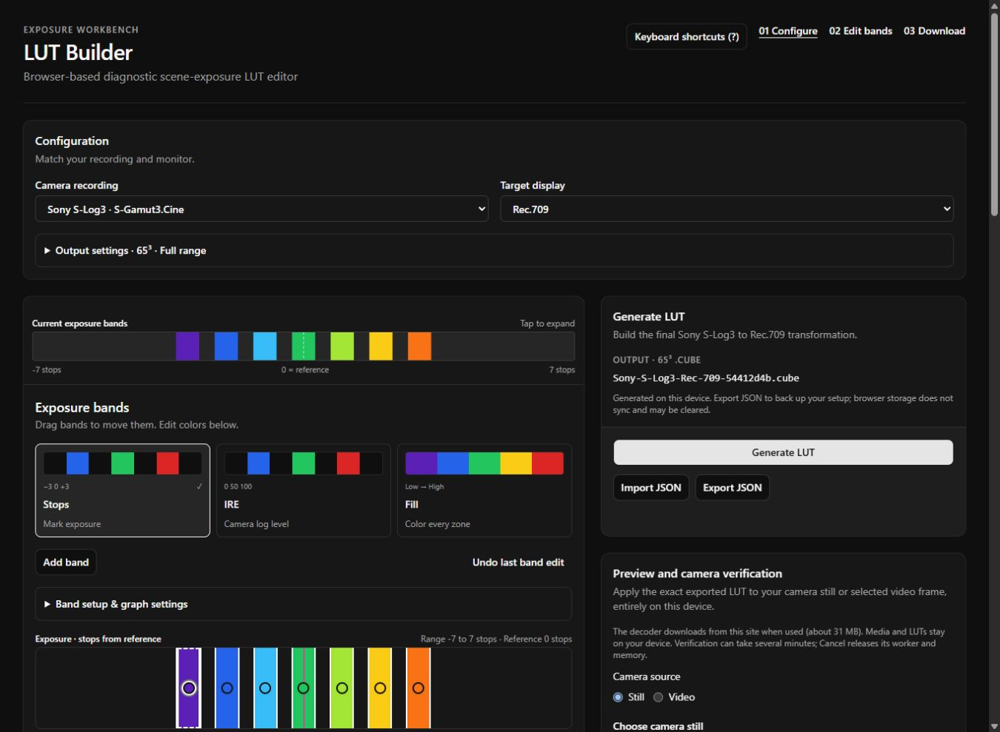

# LUT Builder

Make custom false-color LUTs to monitor camera exposure. LUT Builder is free and open source. Choose your camera's log and gamut, set exposure bands and colors, then download a `.cube` file.

  
  
  

**[Open LUT Builder on GitHub Pages](https://today20092.github.io/lut_builder/)**

[Make your first LUT](#make-your-first-lut) · [Use your phone](#use-your-phone) · [User guide](docs/guide.md) · [Feedback and support](#feedback-and-support)

## Make your first LUT

The website is the main way to use LUT Builder. No installation, account, or terminal is needed.

1. Choose the log and gamut that match your recording settings. Pick the target display and a cube size your camera or monitor accepts.
2. Choose Stops for exposure relative to 18% gray, IRE for camera-log signal levels, or Fill for continuous color zones.
3. Adjust the bands. Try an exposure palette, edit its gradient, and select **Use palette** to apply it. The sticky preview shows your draft while you scroll; Cancel leaves the current colors unchanged.
4. Select **Generate LUT** and save the `.cube` file. Export JSON too if you want a portable backup of your setup.
5. Load the LUT into compatible monitoring software, a monitor, or a camera. Confirm the signal path and check a gray reference before relying on it.

*Browser interface, October 19, 2026. The exposure diagram shows your band settings; it does not verify a camera image or the exported LUT.*

Named palettes and presets stay in the browser where you save them. They do not sync between devices, and clearing browser storage can remove them. Keep exported JSON backups.

## Use your phone

Bookmark the [web editor](https://today20092.github.io/lut_builder/) so you can make LUTs while shooting. You can also use your browser's **Add to Home Screen** command where available. This creates a shortcut; it does not guarantee offline use. Save downloads in your phone's Files or Downloads app.

Some camera apps can import a downloaded LUT and transfer it to a compatible camera. For example, [LUMIX Lab accepts 33-grid `.cube` files](https://av.jpn.support.panasonic.com/support/global/cs/soft/lumix_lab/en/cts/d0.html), and [Sony Creators' App has LUT Management on supported cameras](https://helpguide.sony.net/di-app/ca/v1/en/contents/CA_camera_screen.html). Model, firmware, app version, and file restrictions apply. See the [phone transfer guide](docs/guide.md#transfer-from-your-phone).

Physical phone testing is still incomplete. The [browser support report](docs/browser-support.md) separates emulated browser checks from checks on real devices.

## Exposure settings that matter

- Match both log and gamut. The current catalog pairs Sony S-Log3 with S-Gamut3.Cine, Panasonic V-Log with V-Gamut, Canon Log 3 with Cinema Gamut, ARRI LogC3 with ARRI Wide Gamut 3, RED Log3G10 with REDWideGamutRGB, and Blackmagic Film Gen 5 with Blackmagic Wide Gamut. See the [profile table](docs/guide.md#supported-camera-profiles).
- Stops uses scene-linear luminance relative to 18% gray. New web-editor IRE setups use the selected camera's encoded signal and gray reference. Older IRE setups retain their original target-based interpretation. See [camera-log IRE](docs/camera-log-ire.md).
- Full or Legal is a LUT output setting, not an automatic camera-model choice. Check the device applying the LUT. See the [range guide](docs/output-range-guide.md).

These are diagnostic exposure LUTs, not finished viewing LUTs or creative grades. They do not add tone mapping or highlight roll-off. Red palette colors and encoded-signal warnings do not prove sensor clipping. LUT size and host interpolation can soften narrow boundaries.

## Local tools and detailed guides

The optional Python Workbench and command line remain available. Camera-matched still and video verification is also available in the browser, with supported formats and limits in the guides below. Media and LUT calculations run on your device.

- [User and development guide](docs/guide.md) covers local setup, commands, exposure math, and loading LUTs.
- [Still verification](docs/still-verification.md) and [video verification](docs/testing/video-verification.md) explain the local tools. [Browser support](docs/browser-support.md) describes on-device browser verification and its limits.
- [Keyboard shortcuts](docs/keyboard-shortcuts.md) covers graph editing, undo, palette controls, and preview navigation.
- [Integration report](docs/testing/integration.md) records acceptance checks.
- [Color and LUT research](docs/research/false-color-lut-correctness.md) records source evidence and numerical coverage.
- [Contributing](Contributing.md) covers code changes and camera-profile contributions.

## Feedback and support

Thank you to the videographers and everyone using LUT Builder. The goal is to make exposure monitoring easier with a free, open-source tool. User requests have already helped shape the editor.

The most useful contribution is feedback. [Open a GitHub issue](https://github.com/Today20092/lut_builder/issues) for confusing controls, LUT results, missing features, camera profiles, or tutorials that need work. Include your camera's log/gamut, the device applying the LUT, and steps to reproduce the problem. Attach setup JSON or screenshots when useful, and remove private information first.

If the tool helps your work, you can support its development through [GitHub Sponsors](https://github.com/sponsors/Today20092) or [Ko-fi](https://ko-fi.com/ayoubab1). Both are listed in the repository's Sponsor section.

## Roadmap

The browser editor is available now. Current priorities are real phone and camera/monitor testing, clearer tutorials, and profile coverage backed by source evidence. Follow [GitHub Issues](https://github.com/Today20092/lut_builder/issues) for ongoing work.

## License

[MIT](LICENSE) for LUT Builder's code. The optional browser decoder has its own
[third-party license and source notices](THIRD_PARTY.md).
