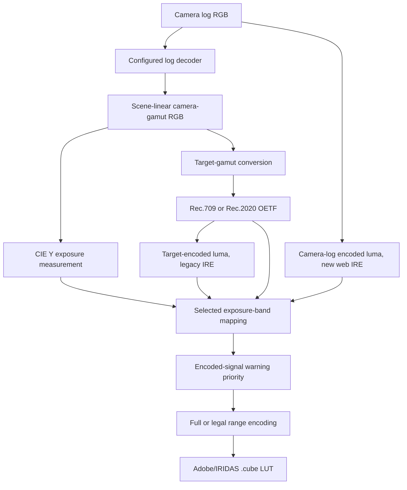

# LUT Builder guide

[Back to the README](../README.md)

Start with the [web editor](https://today20092.github.io/lut_builder/) to make a LUT without installing anything. Use this guide for exposure settings, phone transfer, optional local tools, and development.

## Browser workflow

Choose your recording's log/gamut pairing, then edit Stops, IRE, or Fill bands. Drag the graph controls or edit the values in the table. Numeric fields commit on Enter or blur; Escape discards an unfinished edit. Undo restores the last band edit.

The starting palettes use cool colors below the reference, green at the reference, and warm colors above it. Select a palette to audition it, edit gradient colors, then choose **Use palette**. A preview remains visible while scrolling. Cancel preserves the applied colors. See [palette behavior](exposure-palettes.md) and [keyboard shortcuts](keyboard-shortcuts.md).

Generate and download the `.cube`, then export JSON to back up your applied settings. Browser presets and named palettes do not sync. Clearing storage or changing browsers can remove access to them.

Browser still/video verification applies the serialized LUT on-device. It requires confirmed source interpretation and has format, size, and duration limits. Check the [browser support matrix](browser-support.md) before importing media. The exposure graph describes settings; it is not a camera verification result.

## Transfer from your phone

Bookmark the [web editor](https://today20092.github.io/lut_builder/). In Safari on iPhone, use the [bookmark controls](https://support.apple.com/guide/iphone/bookmark-a-website-iph42ab2f3a7/ios). In Chrome on Android, use the [bookmark menu](https://support.google.com/chrome/answer/188842?hl=en&co=GENIE.Platform%3DAndroid). Your browser may also offer Add to Home Screen. A shortcut does not guarantee offline use.

1. Generate the LUT with a cube size your destination accepts, and save it in Files or Downloads. A JSON setup is a backup for LUT Builder, not a LUT file for the camera.
2. Import the `.cube` through your camera app's supported LUT workflow, or copy it to a card using the camera's instructions.
3. Use it for monitoring. Check whether the camera's chosen LUT mode also records the effect; avoid baking false colors into footage unintentionally.

[LUMIX Lab](https://av.jpn.support.panasonic.com/support/global/cs/soft/lumix_lab/en/cts/d0.html) accepts 33-grid `.cube` files. Choose **33³** in LUT Builder, add the file to the app's Device LUT library, then use Transfer to Camera with a compatible connected model. Panasonic documents transfer in its [LUMIX Lab guide](https://av.jpn.support.panasonic.com/support/global/cs/soft/lumix_lab/en/cts/b1.html).

[Sony Creators' App](https://helpguide.sony.net/di-app/ca/v1/en/contents/CA_camera_screen.html) offers LUT Management and import from the smartphone on supported cameras. Check Sony's linked compatibility list and your firmware; app connectivity alone does not establish custom-LUT support. Some workflows use Creators' Cloud instead. This is not a claim that every Sony camera, including the a7 III, can import a custom LUT.

App support and recording-profile support are separate. Match the camera's actual input log/gamut to the LUT and verify the monitoring path before a shoot. Phone download/share and physical camera transfer testing remain incomplete.

## Optional local setup

The web editor is the primary workflow. Install the Python tools if you want the local Workbench, CLI regeneration, or local media verification.

Install [Git](https://git-scm.com/) and [uv](https://docs.astral.sh/uv/getting-started/installation/), then run:

```sh
git clone https://github.com/Today20092/lut_builder.git
cd lut_builder
uv sync --locked
uv run lut-builder workspace
```

uv manages Python 3.12 or newer. The Workbench opens at [127.0.0.1:8765](http://127.0.0.1:8765/). Keep the terminal open; press Enter or Ctrl+C to stop it. If that port is occupied, close the other workspace or application and retry. Use the same address and browser to retain access to browser-stored presets.

After setup on Windows, double-click [workspace.bat](../workspace.bat) for the Workbench or [build.bat](../build.bat) for the CLI. On macOS, run `chmod +x build.command` once, then double-click [build.command](../build.command). The [still](still-verification.md) and [video](testing/video-verification.md) guides list local FFmpeg/FFprobe prerequisites.

## Commands

| Command | Purpose |
| --- | --- |
| `uv run lut-builder workspace` | Open the local browser workspace. |
| `uv run lut-builder build` | Build a LUT interactively. |
| `uv run lut-builder build --config setup.json` | Regenerate a saved setup without prompts. |
| `uv run lut-builder build --config setup.json --output-dir ~/luts` | Regenerate into a chosen directory. |
| `uv run lut-builder list` | List camera profiles, output encodings, and profile sources. |
| `uv run lut-builder colors` | Browse the bundled Tailwind color palette. |
| `uv run lut-builder colors blue` | Filter the palette by family name. |

Run `uv run lut-builder --help` or add `--help` after a command for the current options.

## Interactive CLI workflow

You can enter `b` at supported prompts to return to the previous step.

1. Select a camera log profile.
2. Select Rec.709 or Rec.2020 diagnostic output.
3. Choose a 17, 33, or 65 point cube.
4. Choose Stops, IRE, or Fill mode.
5. Define exposure values, colors, and band widths.
6. Enable optional low and high encoded-signal warnings.
7. Choose a monochrome or color base where applicable.
8. Choose full or legal output range.
9. Name the `.cube` file.
10. Optionally save the setup as JSON.

Cube size 65 gives sharp transitions the most lattice resolution. Sizes 17 and 33 are faster and smaller, but host interpolation can soften narrow false-color boundaries.

## Exposure modes

### Stops

Stops are calculated from scene-linear CIE Y relative to 18% middle grey:

```text
stops = log2(Y / 0.18)
```

CIE Y uses the selected camera gamut's RGB-to-XYZ matrix instead of applying fixed Rec.709 luma weights to wide-gamut camera RGB.

### IRE

New web-editor IRE selections measure camera-log encoded RGB luma before the viewing conversion. The reference depends on the selected profile's log curve. Values use a full-code-range percentage, with codes 0 to 1023 corresponding to 0 to 100. This does not promise the same reading on every camera waveform or monitor range setting.

Older setups without `ire_basis`, and the existing CLI default, retain target-encoded IRE. The editor labels these legacy setups and offers an undoable switch to camera IRE with fresh band presets. Exported JSON preserves the interpretation. See [camera-log IRE and exposure](camera-log-ire.md) for references, colored-pixel behavior, and compatibility.

LUT output range is independent of the IRE measurement. Full writes 0–1; Legal packs output into 64/1023–940/1023. Choose Legal only when the device applying the LUT requires it and does not repeat that packing. See the [output-range guide](output-range-guide.md).

### Fill

Fill mode creates full-coverage false-color zones with no unpainted base image. In the web editor, drag separators or edit the boundary fields to set where one color gives way to the next. The final zone fills the rest.

### Encoded-signal warnings

Low and high warnings inspect each encoded input channel independently. One channel crossing its profile threshold is enough to trigger the warning color.

These warnings identify encoded-signal boundaries. They do not prove physical sensor clipping, which can vary by camera model, recording mode, exposure index, and processing pipeline.

## Example Setup

```text
Mode:          Stops
Stops:         -2, -1, 0, +1, +2
-2 stops:      blue-800    #1e40af
-1 stop:       sky-400     #38bdf8
 0 stops:      green-500   #22c55e
+1 stop:       yellow-400  #facc15
+2 stops:      orange-500  #f97316
Low warning:   violet-600  #7c3aed
High warning:  red-600     #dc2626
Band width:    Standard, ±0.3 stops
Base:          Monochrome
Range:         Full/data
```

Bands are applied from low to high exposure, so higher-position bands win where ranges overlap. Bands at the same position retain creation order. Encoded-signal warnings are applied after exposure bands and therefore have final priority.

## Supported camera profiles

| Profile | Camera gamut | Common camera families |
| --- | --- | --- |
| Sony S-Log3 | S-Gamut3.Cine | FX3, FX6, FX9, a7S III, VENICE |
| Panasonic V-Log | V-Gamut | Lumix S series, GH6, BGH1, VariCam |
| Canon Log 3 | Cinema Gamut | C70, C300 Mark III, C500 Mark II |
| ARRI LogC3 | ARRI Wide Gamut 3 | ALEXA, AMIRA, ALEXA LF |
| RED Log3G10 | REDWideGamutRGB | V-RAPTOR, KOMODO, MONSTRO |
| Blackmagic Film Gen 5 | Blackmagic Wide Gamut | Pocket Cinema Camera 4K/6K, Cinema Camera 6K, PYXIS, URSA Mini Pro 12K |

Run `uv run lut-builder list` for the catalog currently installed with your checkout and the source URLs associated with each profile.

Profile names describe signal encodings, not guarantees for every camera mode. Verify the selected gamut, log curve, range, and monitoring path against your camera settings.

## Diagnostic Outputs

| Output | Primaries | Transfer function |
| --- | --- | --- |
| Rec.709 | ITU-R BT.709 | ITU-R BT.709 OETF |
| Rec.2020 | ITU-R BT.2020 | ITU-R BT.2020 OETF |

Configured overlay colors have sRGB meaning. LUT Builder converts them into the selected target gamut before writing them, while preserving the intended Rec.709 values.

## Output Files

| Input | Result |
| --- | --- |
| `my_lut` | `output/luts/my_lut.cube` |
| `my_lut.cube` | `output/luts/my_lut.cube` |
| `custom/my_lut.cube` | `custom/my_lut.cube` |
| `--output-dir D:\LUTs` | `D:\LUTs\<filename>.cube` |

The CLI creates required parent directories. Generated `.cube` files and saved JSON configs are ignored by Git.

### Saved configurations

New setups are saved as version 2 JSON. Existing version 1 configs remain supported and normalize into the same validated setup used by interactive sessions.

```json
{
  "version": 2,
  "profile": "Panasonic V-Log",
  "target": "Rec.709",
  "cube_size": 33,
  "bands": [
    {"stop": 0.0, "color": "#22c55e", "width": 0.3}
  ],
  "band_mode": "stops",
  "ire_basis": "camera",
  "fill_mode": false,
  "low_signal_warning": true,
  "low_signal_hex": "#7c3aed",
  "high_signal_warning": true,
  "high_signal_hex": "#dc2626",
  "monochrome": true,
  "legal_range": false,
  "output": "panasonic_false_color.cube"
}
```

Regenerate it with:

```bash
uv run lut-builder build --config setup.json
```

## Loading the LUT

### DaVinci Resolve

Open the Color page, open the LUT folder from the LUTs panel, copy the `.cube` file into it, and refresh the LUT list.

### Panasonic Lumix

Copy the LUT to the camera's supported custom-LUT location, then assign it through LUT View Assist. Confirm the camera's supported cube size and file naming rules first.

### Premiere Pro and Final Cut Pro

Import the `.cube` file as a custom LUT in the application's color workflow. Use it as a monitoring diagnostic, not as the final creative grade.

## How it works



The profile catalog validates camera and target facts explicitly. Interactive prompts and JSON files are adapters into the same `LutSetup`, and preview and generation share one exposure-mapping implementation.

Colour transitions inside a finite 3D LUT depend on cube resolution and the host's interpolation. Tests exercise neutral ramps at sizes 17, 33, and 65, including band edges and the current half-grid warning tolerance.

For the standards audit and source references, see [False-color LUT correctness](research/false-color-lut-correctness.md).

## Project Layout

```text
lut_builder/
├── src/lut_builder/
│   ├── cli.py       # Commands, prompts, preview, config I/O
│   ├── colors.py    # Tailwind OKLCH palette
│   ├── data.py      # Validated camera and target catalog
│   ├── engine.py    # Decode, transform, overlay, and LUT output
│   ├── presets.py   # Suggested colors and band widths
│   └── setup.py     # Shared setup validation and exposure mapping
├── tests/           # Numerical, semantic, CLI, and regression checks
├── docs/            # Research and agent guidance
├── frontend/        # Shadcn workspace source
├── build.bat        # Windows launcher
├── build.command    # macOS launcher
├── workspace.bat    # Windows browser workspace launcher
└── pyproject.toml   # Package metadata and dependencies
```

## Development

Use UV for Python dependencies and execution, Ruff for formatting and linting,
and ty for type checking. Tool versions are recorded in `uv.lock`.

```bash
uv sync --locked
uv run pytest -q
uv run ruff format --check .
uv run ruff check .
uv run ty check
uv run lut-builder --help
uv run lut-builder list
```

From `frontend/`, run `pnpm install --frozen-lockfile`, `pnpm lint`, `pnpm test`, and `pnpm build`. The build checks TypeScript and regenerates bundled assets in `src/lut_builder/static/`; include those assets with frontend changes. The Pages workflow builds separately for the repository URL.

Run `uv run ruff format .` to apply formatting before submitting changes.

The current suite covers config compatibility, catalog validation, log decoding, exposure mapping, signal-range semantics, target-gamut overlays, interpolation boundaries, and CLI output paths.

## Contributing

Read [Contributing.md](../Contributing.md) before adding a profile or changing LUT behavior. Camera and transfer-function facts should have primary-source documentation and numerical coverage.

Coding agents should start with [AGENTS.md](../AGENTS.md). Repository-specific issue, triage, domain, and research guidance lives under [docs](./).

Bug reports and profile requests belong in [GitHub Issues](https://github.com/Today20092/lut_builder/issues).

## License

MIT. See [LICENSE](../LICENSE).
