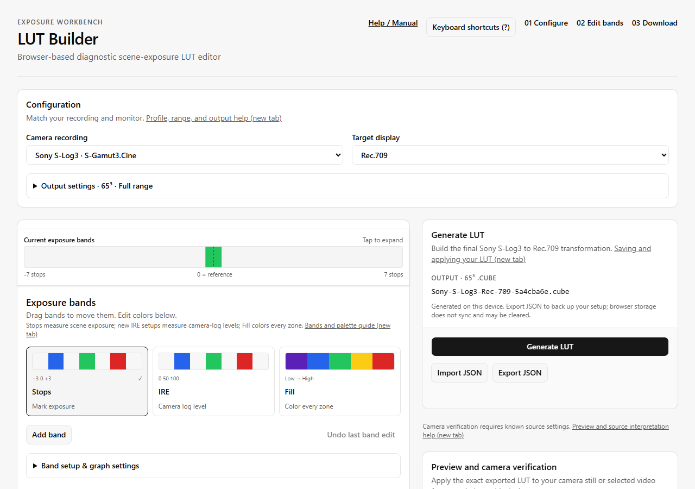

Keep the builder open in another tab while following these steps. Your camera's log curve and gamut must match the selected profile; a camera brand alone is not enough.

On a first visit, choose your **Camera / log profile** and **Display color space**,
then **Choose exposure preset**. Each preset shows its actual band arrangement
and explains its purpose. Choose **Start editing** to customize it; no media upload
is required. **Continue editing** skips this setup flow.

Returning visitors resume their last saved setup. To start again, choose **New LUT**
in the desktop header or **Settings → New LUT** on a phone. Cancel to return to your
current work, or start a new LUT and use **Settings → Saved setups → Restore previous setup** if
needed. Recovery lasts until the page is closed or another setup is loaded.

## 1. Match the recording

:::tip[Before you start]
Have the recording's log curve and gamut, the receiving device's supported cube size, and a known gray reference ready. Keep both the `.cube` and the editable JSON at the end.
:::

In **Configuration**, choose **Camera recording**. For example, use **Sony S-Log3 · S-Gamut3.Cine** only when your source is S-Log3 with S-Gamut3.Cine. S-Gamut3, S-Log2, and already converted Rec.709 are different inputs.

Choose **Target display** to match the destination. Use Rec.709 for an SDR Rec.709 monitoring path. Rec.2020 here is an SDR diagnostic output, not an HDR conversion.

Open **Output settings**. Select a cube size supported by your device: 33³ is a useful starting point if supported; 65³ samples narrow transitions more closely but produces a larger file. Keep **Full / Data** unless the receiving path specifically expects **Video / Legal** LUT output. This setting changes output, not the camera input interpretation.

## 2. Mark exposure bands

Choose **Stops** under **Exposure bands**. Zero means 18% scene-linear gray; +1 is twice that light, and −1 is half. This is not a rule that every subject should be exposed at zero.

For a simple example, keep three bands and enter these values in the table. Remove unwanted bands with **Remove**, then **Confirm remove**. **Add band** creates another row.

| Position (stops) | Total width | Color | Meaning you assign |
| ---: | ---: | --- | --- |
| −2 | 0.6 | `#2563eb` | Two stops below reference |
| 0 | 0.6 | `#22c55e` | Reference band |
| +2 | 0.6 | `#facc15` | Two stops above reference |

Click a color swatch and enter the hex value. Press Enter or leave a numeric field to commit a valid edit. The zero band now covers −0.3 through +0.3 stops. Outside the bands, the base image remains visible. **Monochrome base** makes those gaps gray.

**Observable result:** the exposure diagram shows three colored regions separated by gaps. Widening the zero band's total width from 0.6 to 1.0 extends it to −0.5 through +0.5. **Undo last band edit** restores the previous edit; it is one step deep.

For continuous color coverage, choose **Fill** instead. Fill uses boundaries between zones rather than band widths. [Compare Stops, IRE, and Fill](../controls/#exposure-bands).

## 3. Try a palette

Under **Recolor all bands**, choose a palette or customize a gradient. Review the draft in the exposure diagram, then choose **Use palette** to apply it. **Cancel preview** keeps your existing band colors. Applying a palette replaces individual swatch colors but preserves band geometry.

> **Preview → apply → export.** A draft preview is not exported. If you want the exact three colors in the example above, keep them instead of applying a palette.

## 4. Understand the warnings

The **Low recorded-signal warning** and **High recorded-signal warning** can override your bands. Purple and red are editable indicator colors, not measurements of sensor noise or clipping. Any one encoded RGB channel can trigger a warning; high wins if both trigger.

For your first test, note whether each warning is enabled. Read [how the limits are calculated](../signal-limits/) before treating a purple or red region as an exposure decision.

## 5. Generate and keep both files

Choose **Download LUT** and save the `.cube` download. The filename preview shows the name the builder requests; your browser may add a duplicate-download suffix. Then choose **Export setup file** to save the editable setup. The cube is for your camera or editor; the JSON is for reopening your settings in LUT Builder.

## 6. Apply it to the correct signal

Load the cube into a compatible LUT slot. Feed that slot the selected camera log/gamut, before an unrelated log-to-display conversion or creative grade. Avoid applying an additional display transform that would change the diagnostic colors afterward. Match the full/legal output handling to the device.

Check a known gray reference or controlled exposure ramp in the actual monitoring path. A monitor's native false-color mode may label exposure differently from your custom LUT. Consult the device's LUT size, file format, and range requirements; there is no universal camera menu sequence.

The builder's diagram and demonstration image are illustrations. To check actual camera samples against the exported cube, use [camera-matched verification](../verification/).

## Read the interface

Captured from the browser build on October 19, 2026. **Configuration** selects the input and output. **Exposure bands** chooses the kind of exposure labels. The strip above it summarizes the current bands; it does not measure a camera image. **Help / Manual** in the header keeps instructions within reach.
