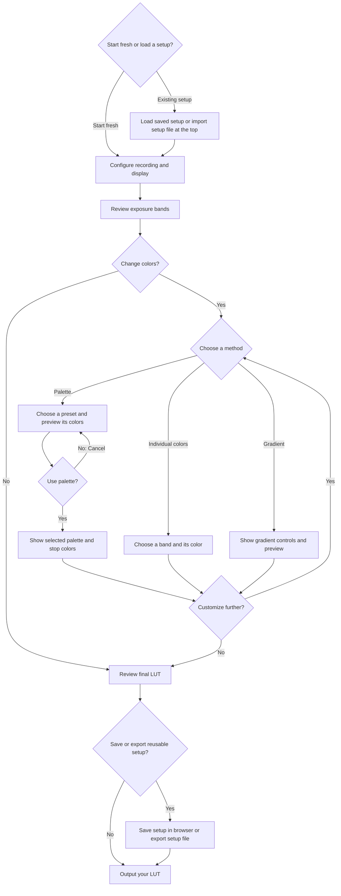

# Mobile UX: simplify the workflow, navigation, and touch controls

This issue collects the mobile UX feedback to date. Add further observations to this same issue.

Screenshot references below identify images supplied during feedback collection; the image files are not embedded in this issue.

## Scope

Focus on the phone layout and touch interaction on Android and iPhone. The attached screenshots show the current Android experience; iPhone behavior still needs verification.

This is also a user-experience ticket: the tool should be clear, concise, quick, accessible, and understandable through its controls. Present choices in a top-to-bottom sequence ending in LUT output. Avoid making users read long explanations to understand routine actions. Apply the same workflow principles to desktop where relevant, while prioritizing phones.

## 1. Top navigation wraps unevenly and includes keyboard shortcuts

The header currently displays Keyboard shortcuts (?), 01 Configure, 02 Edit bands, and 03 Download across two rows. The keyboard-shortcuts button is visually larger than the other navigation actions, making the layout look inconsistent and misaligned.

Requested behavior:

- Hide the keyboard-shortcuts action in the phone layout.
- Aim for a single compact row for Configure, Edit bands, and Download.
- Use consistent sizing, alignment, spacing, and comfortable touch targets.
- Keep navigation usable on narrow phone screens without clipping or horizontal page overflow.

Reference: supplied screenshot 17649.jpg.

## 2. Visible range should use a touch-friendly numeric selector

Visible range (± stops) currently uses an editable number field. Tapping it opens the phone keyboard, which occupies much of the screen and makes changing the graph range cumbersome.

Requested behavior:

- Replace the phone text-entry interaction with a touch-friendly numeric selector that does not require opening the keyboard.
- Consider a scrolling number picker or a horizontal/vertical slider; the precise control is still open.
- Let the user choose the range magnitude starting at 1 stop. An upper limit around 15 or 20 stops was suggested; the final maximum remains to be decided.
- Clearly show the selected value and that it represents a symmetric range, for example ±7 stops.
- Changing the visible range must continue to zoom the graph without changing exposure-band positions or colors.

Reference: supplied screenshot 17647.jpg, showing the numeric keyboard open.

## 3. Canceling a palette preview loses the user's place

In Recolor all bands, selecting a preset opens a preview with Use palette and Cancel. Cancel currently scrolls the user away from the place where they were choosing the preset.

Requested behavior:

- Cancel discards the preview and restores the current band colors.
- Preserve the user's place in the palette chooser, including when the preview panel changes height or disappears.
- Keep focus in a sensible location so touch, keyboard, and assistive-technology users can continue choosing a palette.
- Verify repeated preview/cancel cycles without unexpected jumps.

Reference: supplied screenshot 17653.jpg and the reported interaction.

## 4. Reduce explanatory copy in the recoloring flow

The section currently piles up instructions about previewing and committing colors, unchanged positions and widths, 18% gray / scene-linear exposure, reference meaning, and how fill colors cover existing zones. This creates too much reading before the next useful action.

Requested behavior:

- Use short action labels and clear selected/preview states to explain the immediate task.
- Keep only information needed for the current decision visible by default.
- Move technical background and detailed mapping explanations into optional help when useful; do not repeat them throughout the main flow.
- Keep essential consequences clear at the point of action without paragraphs explaining ordinary buttons.
- Review this as an interaction-design problem, not merely a copy-shortening exercise.

Reference: supplied screenshots 17653.jpg and 17657.jpg.

## 5. Preserve the useful presets and stop-color swatches

The two existing starting palettes, Exposure zones and Reference emphasis, are liked and should remain available.

The Stops from reference row is also liked: individual colored squares labeled −3, −2, −1, 0, +1, +2, +3 make the mapping easier to understand. Preserve this visual approach and show the relevant palette colors when a palette is selected.

Reference: supplied screenshot 17657.jpg, particularly the circled swatch row.

## 6. Make gradient editing an explicit optional path

Shape your gradient currently follows the palette choice as numbered step 2, making it look mandatory. A user who has already chosen a satisfactory palette or color should not have to encounter blend, hue-path, and gradient controls to finish.

Requested behavior:

- Show controls that belong to the user's current choice.
- Reveal gradient controls only when the user explicitly chooses to create or customize a gradient.
- Let users accept a palette, change individual band colors, or keep existing colors and proceed directly toward output.
- Do not display irrelevant or currently unavailable controls as required steps.
- Organize the screen in decision order, with a clear next action and LUT output as the final step.

### Proposed choice flow for discussion

This is a proposed user-facing flow, not a description of the current implementation. Exact labels and grouping remain open.

Cancel returns to the same palette-choosing location with the previously committed colors intact. Only the chosen method's controls appear; users can explicitly switch methods to customize further.

## 7. Gradient touch controls compete with vertical page scrolling

The gradient editor works well on desktop, but its circles/stop handles and Lightness, Chroma, and Hue sliders are difficult to adjust precisely on a phone. While scrolling down the page, users can accidentally move a gradient stop or change a color value. Horizontal movement within the gradient bar also competes with selecting and dragging its handles.

Requested behavior:

- Design the mobile editor around vertical page scrolling and touch input, rather than relying on desktop dragging interactions.
- A gesture intended to scroll the page must not change stop positions or Lightness, Chroma, or Hue values, including when it starts over an interactive control.
- Make selecting a stop and deliberately adjusting it easy and precise, with comfortably sized, well-spaced touch targets and a clear selected state.
- Distinguish page scrolling, horizontal movement within the gradient bar, selecting a stop, and moving a stop. Do not leave users guessing which action a swipe will perform.
- Review Add color and Remove color alongside the handles and color controls as one mobile editing flow.
- Consider a dedicated edit mode, an explicit activation step, or another touch-safe control design. These are possible approaches, not a prescribed implementation; the outcome is reliable scrolling and intentional editing.
- Preserve the useful desktop editing experience while adapting the phone interaction.

Reference: supplied screenshot 17658.jpg and the reported accidental adjustments.

## 8. Remove the redundant bottom preview and numbered preview step

After choosing settings, the user reaches 3. Preview and apply with another color preview, even though Current exposure bands is already sticky at the top of the phone screen. Showing both previews adds screen length and makes previewing look like another required task.

Requested behavior:

- Use the sticky top preview as the single preview surface throughout palette and gradient editing on mobile.
- Remove the redundant bottom preview and the numbered Preview and apply step.
- Ensure the top preview reflects pending edits and clearly distinguishes a draft from committed colors, so removing the lower preview does not hide the result being considered.
- Keep a clear Use palette/apply action when changes need committing, without requiring a separate preview stage or repeating explanatory paragraphs.
- Keep pending-change status and apply/cancel behavior consistent with the earlier palette-selection flow.
- Let users continue toward LUT output after applying their choices.

Reference: supplied screenshot 17662.jpg, showing the sticky top preview and bottom preview together.

Flow clarification: Review final LUT in the proposed diagram means checking the existing preview and output choices, not adding another preview panel or mandatory preview step.

## 9. Put setup loading at the start and saving/exporting at the end

Saved LUT setups currently appear near the bottom of the page. A returning user has to scroll down to load their setup, return to the top to review and adjust settings, then scroll down again to save/export. This breaks the intended top-to-bottom mobile workflow.

Desired journey: open the tool → optionally load/import an existing setup at the top → review and adjust settings while moving down → optionally save/export the reusable setup → output the LUT.

Recommended design for discussion:

- Provide a compact Load setup entry point near the top, before configuration. Make it available on initial arrival without scrolling through the editor.
- From that entry point, offer browser-saved setups and setup-file import with clear labels. A first-time user should be able to continue with a fresh setup without a required loading step.
- Keep Save current setup and setup-file export near the end, where the user has finished making adjustments.
- Put setup saving/exporting alongside the final output area, keeping LUT output as the final primary action. Saving a reusable setup must remain optional.
- Keep browser-saved setups, portable setup files, color palettes, and generated LUT files understandable as distinct choices through concise labels. Do not make users read an essay to discover which action restores their settings.
- Avoid requiring a round trip to the bottom just to begin an editing session. After loading, leave the user ready to review configuration from the start of the editing flow.

The user is considering this placement and requested suggestions; the split between loading at the top and saving/exporting at the bottom is a recommendation, not a finalized screen design. Exact grouping and labels remain open.

Reference: supplied screenshot 17663.jpg, showing Saved LUT setups near Generate LUT. The screenshot shows browser save/load controls; setup-file import/export placement is also covered by the requested workflow.

## 10. Add a visual confirmation summary to Generate LUT

The Generate LUT section is generally good and should retain its clear final action. It already shows the transformation, cube size (for example 33³), and filename, but it needs a complete, easy-to-scan confirmation of the settings that will actually be exported.

Requested behavior:

- Present the summary inside Generate LUT, immediately before the final generation action, so the user can confirm “this is what I selected” at the end of the top-to-bottom workflow.
- Include the selected camera recording/profile, target display, output cube size and range, and output filename.
- Clearly show the selected diagnostic mapping: IRE or exposure stops, and the selected fill/mapping behavior, as applicable to the chosen setup.
- Show the actual band colors and their corresponding boundaries/values using a compact, labeled visual strip or swatches. Make the selected mapping understandable at a glance rather than listing colors as paragraphs or hex strings alone.
- Include enabled warning indicators and their colors when they affect the generated result; keep irrelevant settings out of the summary.
- Favor color, visual grouping, and short labels over a text-heavy settings dump. Keep values and labels available so meaning does not depend on color alone.
- Reflect the current settings that generation will use, including after importing a setup or changing earlier choices. Do not present uncommitted palette drafts as the final output.
- Keep Generate LUT as the clear final action. The summary itself provides confirmation; an extra confirmation dialog or required checkbox is not requested.

This is a final output summary, distinct from the duplicate gradient-preview stage described in item 8. Do not restore a separate numbered Preview and apply step or another gradient-editing panel to satisfy this request.

Reference: supplied screenshot 17667.jpg. It also confirms Import JSON currently sits at the bottom; move its entry point to the top as proposed in item 9, while keeping Export JSON near completion.

## 11. Redesign media preview around images and an obvious benefit

The current Preview and camera verification section is unclear: users cannot easily identify the primary action, what to do first, or what they gain. It begins with source selection, technical format restrictions, transfer/gamut choices, and confirmations instead of showing an image. This area needs its own substantial design work within this ticket.

Requested experience:

- Lead with the purpose, such as “How will your LUT look on an image?”, and an actual reference-photo preview rather than a form.
- Provide a small set of default reference scenes that work without uploading anything: for example bright/high-exposure, dark/low-exposure, neutral, portrait, nature, indoor, and outdoor scenes. Exact collection and count remain open.
- Let users switch scenes with an obvious selector and swipe on phones. Provide accessible buttons or equivalent controls as well, so swiping is not the only way to browse.
- Show the effect of the selected LUT/settings on the chosen scene, with clear original/result identification. Keep the preview synchronized with the settings being evaluated.
- Make “Use your own image or video” an optional secondary path. A user should be able to replace the sample with their own photo, portrait, camera still, or video when useful.
- Prioritize an immediate, lightweight sample-preview experience on mobile. Keep the custom-source workflow useful on desktop, where users are more likely to have original camera media; do not prohibit mobile users from choosing their own media.
- Reveal source-specific options, compatibility information, and any required confirmations only when the chosen custom-media path needs them. Use concise, actionable language rather than leading with decoder details, bit depths, file-size/pixel limits, or technical checkboxes.
- Keep processing/loading/error states and primary actions clear. State relevant compatibility limits when selecting a source or explaining a failure, rather than making users interpret a wall of constraints before starting.

### Sample media and color correctness

- Use openly licensed reference photos with verified redistribution rights and appropriate attribution. The user offered to source candidates; no particular collection or images have been selected yet.
- Confirm and record each sample's actual transfer function, gamut/color space, and relevant encoding/range information. Do not assume “Rec.709” or “sRGB” from appearance or a filename.
- Design the sample-preview pipeline for the selected LUT's input interpretation. A display-referred sRGB/Rec.709 photo must not be passed directly into a camera-log LUT as though it were original camera data.
- If a sample requires conversion or an approximation, make its role clear with concise optional detail. Distinguish an illustrative sample preview from verification using confirmed original camera media; do not imply the sample proves camera exposure or profile accuracy.
- Keep necessary source validation in the custom-media path, while redesigning how and when users encounter it. Supporting ordinary photos may require pipeline work; hiding existing format restrictions alone does not make those files supported.

### Position in the overall flow

This replaces the current bottom section's form-first presentation. Recommended placement is an optional real-image preview before the final Generate LUT summary/action, so users can evaluate the result before output. This is distinct from both the sticky band-color preview and the redundant gradient preview removed in item 8. Exact placement remains a design decision; it must preserve the top-to-bottom workflow and keep LUT output as the final primary action.

Reference: supplied screenshot 17668.jpg.

## 12. Provide an easy way to report problems or give feedback

Users need an obvious way to report confusing UI, unexpected tool behavior, or anything that does not seem right directly through this repository's GitHub Issues.

Requested behavior:

- Add a clearly labeled Report an issue link/button, with concise supporting text such as “Something confusing or not working? Let us know on GitHub.”
- Link directly to this repository's GitHub Issues reporting entry point. Identify GitHub in the label or nearby text so users know where they are going.
- Recommended placement: a compact, consistently available Help/feedback action in the page header or navigation area, with an optional repeat near the footer. Keep it easy to find on phones without crowding the primary workflow or making feedback a required step.
- Make the action touch-friendly, keyboard accessible, and understandable without relying on an icon alone.
- Keep the initial version simple: a direct GitHub link is sufficient; an embedded feedback form, automatic diagnostic collection, and a new feedback service are not requested.

Exact label and placement remain open to design review. The destination is GitHub Issues, not an external pull request or a separate support channel.

## 13. Implement the workflow with explicit states, events, and tested transitions

Adopt the principles described in Matt Pocock's [The secret to building robust frontend apps with agents](https://youtu.be/r8FYE2ZOj0E): separate UI rendering from the logic controlling it, express interactions as named events, and use reducers to calculate the next state. Keep transition logic independently testable outside the browser.

Use explicit state-machine rules where the workflow has distinct modes and allowed transitions. A reducer calculates the next state from the current state and an event; a state machine defines which states and transitions are valid. These are implementation tools for the user experience described above, not additional user-facing steps.

Implementation expectations:

- Inspect and reuse the existing state transitions and pure editor logic before introducing new structure. No new state-management dependency or whole-application rewrite is required by this ticket.
- Keep React/presentational components focused on rendering state and dispatching named events. Keep workflow decisions in pure transition logic rather than duplicating them across controls.
- Model committed settings and pending palette/gradient drafts distinctly. Derive visible controls, preview status, final summary, and generation readiness consistently from the relevant state.
- Define valid transitions for choosing an editing method, previewing, applying, canceling, loading a setup, and generating output. Prevent contradictory combinations and stale draft/preview results from appearing as committed output.
- Keep browser work, media processing, file operations, and focus/scroll effects at the appropriate boundary. State transitions should specify the intended outcome; a pure reducer alone does not fix scrolling or touch behavior.
- Preserve the repository's Effect conventions for asynchronous application boundaries and keep pure state transitions as plain TypeScript.
- Test important transitions without a browser, then verify scrolling, focus, rendering, and touch behavior in browser/device acceptance checks.

Concrete behavior to cover:

| Event | Expected outcome |
| --- | --- |
| Choose a palette | Preview a draft while preserving committed colors. |
| Cancel preview | Discard the draft and continue at the palette chooser without losing the user's place. |
| Use palette / apply changes | Commit the draft and leave preview mode with consistent controls and status. |
| Choose gradient editing | Reveal gradient controls through an explicit choice. |
| Load a setup | Restore settings coherently and resolve any prior draft so it cannot leak into the loaded setup. |
| Generate LUT | Use committed settings that match the final confirmation summary. |

Keep this guidance in the same ticket because it supports the requested UX outcomes. No separate architecture ticket is required. This principle does not replace the visual, copy, accessibility, or touch-interaction work in items 1–12.

## Verification when implemented

- Check navigation and range selection on Android and iPhone phone layouts.
- Check narrow screens for wrapping, clipping, and horizontal overflow.
- Confirm range selection works with touch without opening the software keyboard.
- Confirm changing the visible range leaves the exposure bands unchanged.
- Confirm Cancel preserves the palette chooser's scroll position and current colors.
- Confirm presets and labeled stop-color swatches remain available.
- Complete the flow using existing colors, a preset, individual colors, and a gradient separately; each path must reach LUT output without requiring an unrelated method.
- Confirm gradient controls appear only after explicitly choosing that method.
- Check touch targets, readable labels, focus continuity, and screen-reader names for the revised choices.
- On Android and iPhone, scroll vertically with gestures starting on gradient handles, the gradient bar, and each color slider; confirm scrolling does not accidentally edit values.
- Check diagonal swipes and canceled gestures for unintended edits.
- Confirm intentional stop selection/movement, horizontal bar navigation, Add color, Remove color, and Lightness/Chroma/Hue adjustments remain usable with touch.
- Recheck desktop pointer editing after any shared-control changes.
- Confirm mobile palette/gradient editing uses one preview surface, with no duplicate bottom preview or numbered preview step.
- Confirm the sticky preview shows pending changes accurately and apply/cancel still produces the expected committed colors and download result.
- Start a returning-user session with a browser-saved setup and separately with an imported setup file; confirm loading is accessible at the top and settings are ready before editing.
- Follow the mobile flow from loading through adjustments to saving/exporting and LUT output without a required trip to the bottom and back to the top.
- Confirm fresh-start users can proceed without loading, and users can output a LUT without first saving/exporting a setup.
- Check the final summary against the settings used to generate the LUT for IRE and exposure-stop setups, applicable fill/mapping choices, band colors/boundaries, and enabled warning indicators.
- Confirm the summary updates after setup loading and subsequent edits, and accurately distinguishes committed output from any pending palette preview.
- Check that the visual summary fits narrow phone screens, retains readable labels, and adds no required confirmation step.
- Confirm a first-time user can see a processed reference image and switch scenes without uploading a file or completing camera-source forms.
- Check swipe browsing and accessible scene-selection controls on phones, and custom-media selection on both mobile and desktop.
- Verify sample licenses, attribution, documented color interpretation, and the conversion/application pipeline for supported LUT input profiles.
- Confirm custom-source requirements appear at the relevant step, unsupported files produce useful guidance, and no essential source validation is lost.
- Confirm image-preview status identifies the settings/result shown and does not imply illustrative samples provide original-camera verification.
- Confirm the feedback action is discoverable and usable on mobile and desktop, opens the correct repository's GitHub Issues reporting entry point, and clearly identifies its destination.
- Cover preview/apply/cancel, editing-method selection, setup loading with a pending draft, and generation from committed settings with focused pure-transition tests.
- Verify that disallowed transitions and stale asynchronous results cannot produce contradictory UI state or a summary/preview that misrepresents the exported LUT.

## Additional feedback

Append subsequent mobile UI observations here, keeping everything in one GitHub issue.
